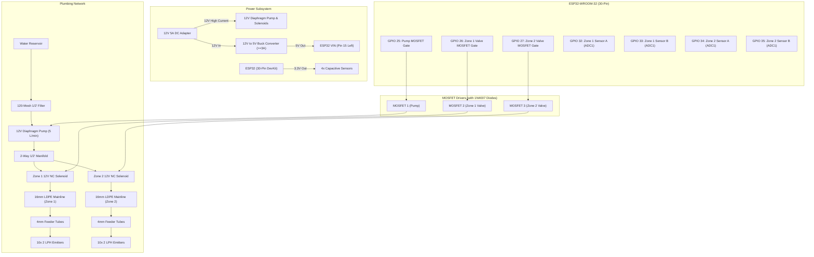

# ESP32 2-Zone Smart Drip Irrigation System

An automated, closed-loop 2-zone drip irrigation system powered by an **ESP32-WROOM-32 (30-pin DOIT DevKit V1)**, **Capacitive Soil Moisture Sensors**, a **12V Diaphragm Pump**, and **12V Solenoid Valves** with logic-level MOSFET switching and hydraulic anti-water-hammer sequencing.

---

## 📋 System Architecture



---

## 📦 Bill of Materials (BOM)

| Category | Component / Specification | Qty | Purpose |
| :--- | :--- | :---: | :--- |
| **Controller** | ESP32-WROOM-32 Dev Board (30-pin DOIT DevKit V1) | 1 | Master controller, ADC sampling, sequencing logic |
| **Pump** | 12V DC Diaphragm Pump, ~5 L/min, 3–5A | 1 | Pressurizes drip network from reservoir |
| **Zone Valves** | 12V DC 1/2" Normally-Closed Solenoid Valve | 2 | Zone isolation (Zone 1 & Zone 2) |
| **Soil Sensors** | Capacitive Soil Moisture Sensor v1.2 / v2.0 | 4 | Corrosion-resistant analog moisture sensing (2 per zone) |
| **Power Supply** | 12V 5A DC Power Adapter | 1 | Main system power source |
| **Buck Converter**| 12V to 5V DC-DC Step-Down Buck Converter ( $\ge$ 3A) | 1 | Steps down 12V to 5V for ESP32 VIN |
| **Drivers** | Logic-level N-MOSFET modules (e.g. LR7843 / IRLZ44N) | 3 | 3.3V logic switching for Pump and 2 Valves |
| **Diodes** | Flyback Diodes (1N4007) | 3 | Suppresses inductive voltage spikes across pump & coils |
| **Main Pipe** | 16mm LDPE / HDPE Drip Irrigation Pipe (25m) | 1 | Zone delivery headers |
| **Feeder Tube**| 4mm Drip Feeder Microtube (25m) | 1 | Branching from 16mm pipe to plants |
| **Drippers** | 2 LPH Pressure-Compensating Drip Emitters | 20 | Consistent water delivery regardless of pipe elevation |
| **Filter** | 120-mesh (130 micron) Irrigation Filter (1/2") | 1 | Prevents sediment from clogging pump and drip emitters |
| **Manifold** | 2-Way 1/2" Water Manifold | 1 | Splits pump output to Zone 1 and Zone 2 valves |
| **Fittings** | 16mm connectors, tees, elbows, 1/2" adapters, clamps | 1 set| Mechanical plumbing connections |

---

## 🔌 Pin Mapping (ESP32 30-Pin DevKit V1)

All analog inputs are strictly mapped to **ADC1** pins (GPIO 32–35) to allow simultaneous Wi-Fi connectivity without ADC conflicts.

| Function | Pin Name | Physical Pin | Direction | Notes |
| :--- | :--- | :--- | :---: | :--- |
| **Pump MOSFET** | `GPIO 25` | Pin 8 (Left) | OUTPUT | Logic HIGH turns pump ON (10k pull-down to GND) |
| **Zone 1 Valve MOSFET** | `GPIO 26` | Pin 9 (Left) | OUTPUT | Logic HIGH opens valve (10k pull-down to GND) |
| **Zone 2 Valve MOSFET** | `GPIO 27` | Pin 10 (Left) | OUTPUT | Logic HIGH opens valve (10k pull-down to GND) |
| **Zone 1 Sensor A** | `GPIO 32` | Pin 6 (Left) | INPUT | Analog ADC1_CH4 (0–3.3V) |
| **Zone 1 Sensor B** | `GPIO 33` | Pin 7 (Left) | INPUT | Analog ADC1_CH5 (0–3.3V) |
| **Zone 2 Sensor A** | `GPIO 34` | Pin 4 (Left) | INPUT (Only) | Analog ADC1_CH6 (0–3.3V) |
| **Zone 2 Sensor B** | `GPIO 35` | Pin 5 (Left) | INPUT (Only) | Analog ADC1_CH7 (0–3.3V) |
| **System 5V Input** | `VIN` | Pin 15 (Left) | POWER IN | 5.0V regulated input from Buck Converter |
| **Sensor Power** | `3V3` | Pin 15 (Right)| POWER OUT| 3.3V output to VCC of all 4 sensors |
| **Common Ground** | `GND` | Pin 14 (L/R) | GROUND | Common reference for 12V, 5V, 3.3V, and MOSFETs |
| **Status Heartbeat LED**| `GPIO 2` | Onboard | OUTPUT | Visual status / error blinking |

---

## ⚠️ Critical Safety & Electrical Rules

1. **Hydraulic Anti-Hammer Sequencing**:
   - **Start Cycle**: Solenoid Valve is opened **500 ms BEFORE** the diaphragm pump starts.
   - **Stop Cycle**: Diaphragm pump is stopped **500 ms BEFORE** the solenoid valve closes.
   - *Failure to follow this sequence will deadhead the pump, causing excessive pressure spikes that rupture pipes or blow fittings.*
2. **Flyback Diodes (1N4007)**:
   - Must be installed **reverse-biased** across the terminals of the pump and each solenoid valve (Cathode with silver stripe connects to `+12V`; Anode connects to MOSFET `Drain` / `Switched Ground`).
3. **Capacitive Sensor 3.3V Power Rail**:
   - Power sensors from the ESP32 **3.3V pin**, **NOT 5V**. This guarantees the sensor's analog output voltage never exceeds the ESP32's 3.3V maximum ADC limit.
4. **Common Ground**:
   - The 12V adapter ground, buck converter input/output ground, ESP32 ground, and MOSFET source grounds must be bonded to a **single common ground plane**.

---

## 📂 Repository Organization

```text
smart-irrigation-system/
├── README.md                           # Master documentation & quick reference (this file)
├── LICENSE                             # MIT License
├── .gitignore                          # Git ignore configuration
│
├── docs/                               # Detailed technical guides
│   ├── architecture.md                 # State machine, hydraulic sequencing, failsafes
│   ├── hardware.md                     # Electrical specs, power budget, MOSFET calculations
│   ├── calibration.md                  # Capacitive sensor 2-point calibration guide
│   ├── plumbing_guide.md               # Hydraulics, filtration, pump priming, drip installation
│   └── developer-guide.md              # Build, flash, test, and contribute guide
│
├── hardware/                           # Drawings & schematics
│   ├── schematics/
│   │   ├── system_wiring_diagram.svg   # High-resolution vector electrical schematic
│   │   ├── plumbing_flow_diagram.svg   # Vector plumbing & hydraulic schematic
│   │   └── wiring_reference.md         # ASCII wiring diagrams and pin connections
│   └── drawings/
│       └── installation_guide.md       # Enclosure layout, sensor depth & weatherproofing
│
├── firmware/                           # Modular production C++ firmware
│   ├── platformio.ini                  # PlatformIO environment configuration
│   ├── include/
│   │   ├── config.h                    # Pinouts, thresholds, timing limits
│   │   ├── soil_sensor.h               # Capacitive sensor driver with noise filtering
│   │   ├── actuator_driver.h           # MOSFET driver with auto-shutoff watchdog
│   │   ├── zone_manager.h              # Zone coordinator (evaluates 2 sensors + 1 valve)
│   │   └── irrigation_system.h         # Master system orchestrator (pump + valve sequencing)
│   └── src/
│       ├── main.cpp                    # Setup & non-blocking execution loop
│       ├── soil_sensor.cpp
│       ├── actuator_driver.cpp
│       ├── zone_manager.cpp
│       └── irrigation_system.cpp
│
└── samples/                            # Step-by-step diagnostic sketches
    ├── 01_sensor_calibration/          # Multi-sensor calibration monitor (all 4 sensors)
    │   └── 01_sensor_calibration.ino
    ├── 02_mosfet_actuator_test/        # Safe sequencing test for pump & 2 valves
    │   └── 02_mosfet_actuator_test.ino
    └── 03_dual_zone_standalone/        # All-in-one standalone sketch for Arduino IDE
        └── 03_dual_zone_standalone.ino
```

---

## 🚀 Quick Start Guide

### Step 1: Calibrate Soil Moisture Sensors
Before planting your sensors, run the calibration sketch to record the dry (air) and saturated (water) ADC values:
1. Open [`samples/01_sensor_calibration/01_sensor_calibration.ino`](samples/01_sensor_calibration/01_sensor_calibration.ino) in Arduino IDE or VS Code.
2. Select board **DOIT ESP32 DEVKIT V1**, connect USB, and upload.
3. Open Serial Monitor at **115200 baud**.
4. Follow the calibration steps in [`docs/calibration.md`](docs/calibration.md).

### Step 2: Verify MOSFET Drivers & Hydraulics
Test your pump and valves without sensor logic to verify wiring and flow:
1. Open [`samples/02_mosfet_actuator_test/02_mosfet_actuator_test.ino`](samples/02_mosfet_actuator_test/02_mosfet_actuator_test.ino).
2. Upload and observe the automated sequence: Zone 1 valve opens $\rightarrow$ pump pulses for 3 seconds $\rightarrow$ pump stops $\rightarrow$ valve closes.
3. Verify no water leaks or electrical resets occur.

### Step 3: Deploy Production Firmware

#### Using PlatformIO (Recommended)
```bash
cd firmware
pio run --target upload
pio device monitor -b 115200
```

#### Using Arduino IDE
You can either open [`samples/03_dual_zone_standalone/03_dual_zone_standalone.ino`](samples/03_dual_zone_standalone/03_dual_zone_standalone.ino) directly, or load the modular firmware from `firmware/src/` into an Arduino sketch.

---

## 📖 Further Reading
- [Hardware & Electrical Guide](docs/hardware.md)
- [System Architecture & Safety](docs/architecture.md)
- [Sensor Calibration Manual](docs/calibration.md)
- [Plumbing & Drip Network Guide](docs/plumbing_guide.md)
- [Developer & Contributing Guide](docs/developer-guide.md)
- [Wiring Reference & Schematics](hardware/schematics/wiring_reference.md)
