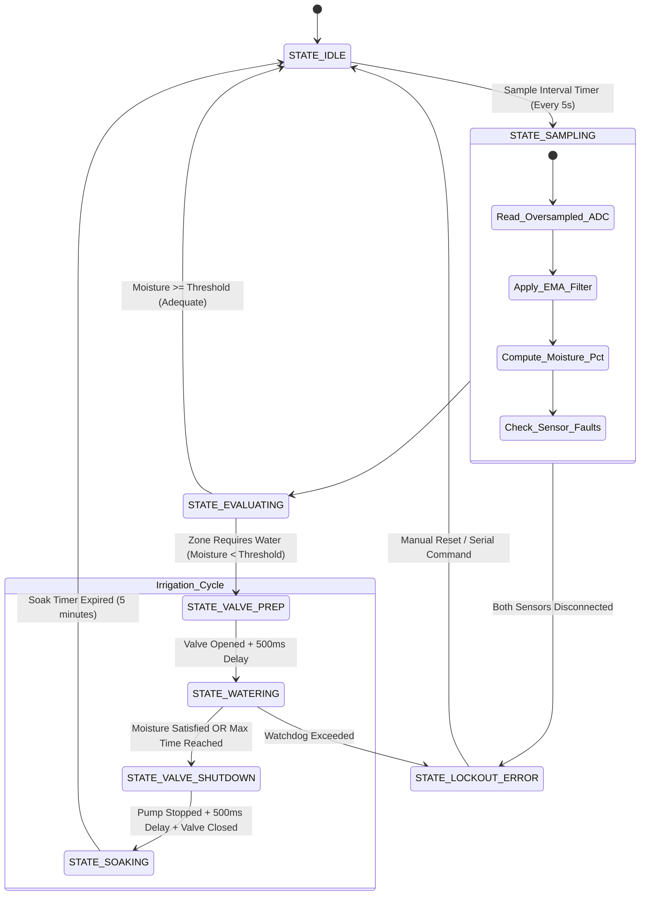
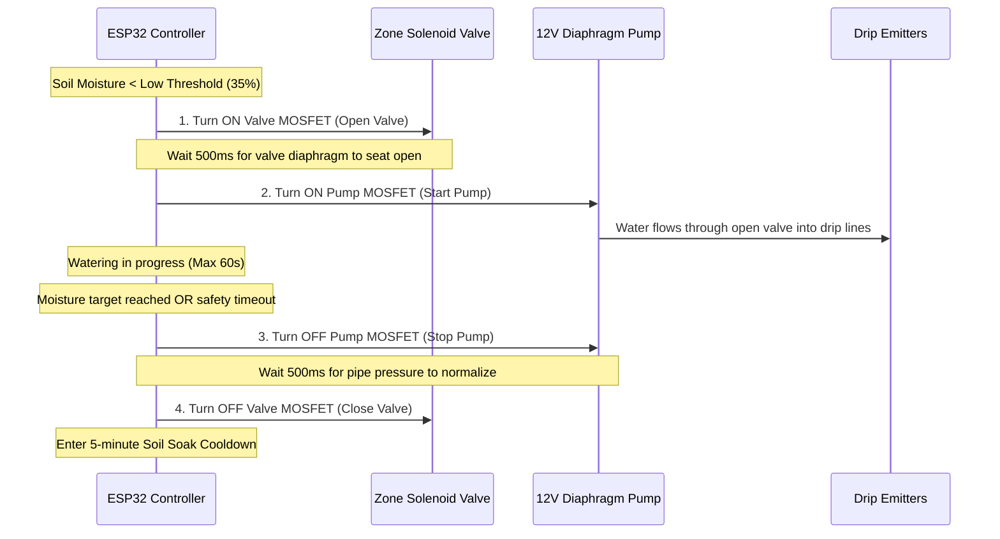

# System Architecture & Control Logic

This document describes the software architecture, finite state machine (FSM), hydraulic sequencing, and fault protection mechanisms implemented in the ESP32 2-Zone Smart Irrigation System.

---

## 1. High-Level Architecture Overview

The system is architected as an event-driven, non-blocking finite state machine running in the Arduino/ESP32 cooperative loop without blocking delays (`delay()` is prohibited). 

---

## 2. Anti-Water-Hammer Hydraulic Sequencing

A diaphragm pump produces high dynamic pressure (~60 to 80 PSI) very rapidly. Starting the pump against a closed solenoid valve ("deadheading") causes extreme hydraulic pressure waves (water hammer) that fatigue fittings, rupture 16mm LDPE pipe, and trip the power supply on overcurrent.

### The Safe Sequencing Protocol

---

## 3. Dual-Sensor Fusion & Fault Tolerance

Each zone is monitored by **two capacitive soil moisture sensors** placed in different positions of the root zone:

### Consensus Logic
1. **Sensor Range Validation**:
   - Valid raw 12-bit ADC range: `1000` (submerged in pure water) to `3800` (dry air).
   - If raw reading is `< 800` (short circuit) or `> 3900` (open circuit / disconnected wire), the sensor is flagged as **FAULTY**.
2. **Zone Moisture Computation**:
   - **Both Sensors Healthy**: Zone moisture is the arithmetic mean:
     $$\text{Moisture}_{\text{zone}} = \frac{\text{Moisture}_{A} + \text{Moisture}_{B}}{2}$$
   - **One Sensor Faulty**: Zone moisture falls back to the single healthy sensor; a warning is logged over Serial/Telemetry.
   - **Both Sensors Faulty**: The zone enters **LOCKOUT**; irrigation is prohibited for this zone to prevent uncontrolled flooding.

---

## 4. Software Safeguards & Watchdogs

| Safeguard | Parameter | Default Value | Purpose |
| :--- | :--- | :---: | :--- |
| **Max Watering Time** | `MAX_WATERING_DURATION_MS` | 60,000 ms (60 s) | Hard cutoff if soil sensor fails to detect water or pipe ruptures |
| **Minimum Soak Time** | `MIN_SOAK_DURATION_MS` | 300,000 ms (5 min) | Allows water to permeate down to root level before re-reading |
| **Valve-Pump Deadhead Delay** | `HYDRAULIC_SEQUENCE_DELAY_MS`| 500 ms | Prevents water hammer and transient pressure shocks |
| **Sensor Read Interval** | `SENSOR_SAMPLE_INTERVAL_MS` | 5,000 ms (5 s) | Non-blocking periodic sampling rate |
| **EMA Smoothing Factor** | `EMA_ALPHA` | 0.20 | Rejects ADC electrical noise and transient spikes |
| **Hysteresis Band** | Low / High Cutoffs | 35% / 65% | Prevents rapid on-off valve oscillation |

---

## 5. Non-Blocking Modular Architecture

The firmware separates concerns cleanly into distinct classes:
- **`SoilSensor`**: Encapsulates 16-sample burst reading, Exponential Moving Average smoothing, calibration math, and fault detection.
- **`ActuatorDriver`**: Controls MOSFET gates, enforces software watchdog auto-shutoff, and tracks runtime.
- **`ZoneManager`**: Couples 2 sensors and 1 valve per zone, maintains zone state (IDLE, WATERING, SOAKING), and tracks zone metrics.
- **`IrrigationSystem`**: Master arbitrator that manages the shared diaphragm pump, executes hydraulic sequencing, and prevents multiple zones from running concurrently.
